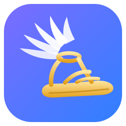

<p align="center"></p>

<h1 align="center">Pedila</h1>

<p align="center"><b>Una ventana sencilla, en español, para usar <a href="https://github.com/NousResearch/hermes-agent">Hermes Agent</a>: el de tu PC y el de tu servidor.</b><br>
<i>Cliente no oficial. Pedila no está hecho ni respaldado por Nous Research.</i></p>

## El nombre

**Pedila** viene del griego **πέδιλα** (*pédila*), las sandalias aladas de Hermes. Los romanos las llamaron *talaria*. Con ellas Hermes, el mensajero de los dioses, llevaba los mensajes de un mundo a otro. Homero lo cuenta dos veces con los mismos versos, cuando Zeus lo envía con un recado (*Odisea* V, 44-46; *Ilíada* XXIV, 340-342):

> αὐτίκ᾽ ἔπειθ᾽ ὑπὸ ποσσὶν ἐδήσατο καλὰ πέδιλα,
> ἀμβρόσια χρύσεια, τά μιν φέρον ἠμὲν ἐφ᾽ ὑγρὴν
> ἠδ᾽ ἐπ᾽ ἀπείρονα γαῖαν ἅμα πνοιῇς ἀνέμοιο.
>
> «Enseguida se ató a los pies las hermosas sandalias, inmortales, de oro, que lo llevaban sobre el mar y sobre la tierra sin límites, tan rápido como los soplos del viento».

Eso quiere ser esta app: las sandalias que llevan tus mensajes hasta Hermes, esté en tu PC o en tu servidor.

**El logo** es una de esas sandalias: suela y tiras de oro, con el ala blanca en el tobillo. Es un dibujo original del proyecto ([`docs/logo.svg`](docs/logo.svg)).

## Qué hace

- **Dos Hermes en una ventana:**
  - **Este PC** usa el mismo Hermes que Hermes Desktop, con los mismos chats.
  - **Servidor** es un Hermes en otra máquina (`hermes dashboard` con usuario y contraseña).
- **Chats:**
  - lista y búsqueda, por título y en el contenido;
  - fijar, renombrar, archivar (con su vista de archivados) y borrar con confirmación;
  - exportar a Markdown.
- **Chat:**
  - respuesta en directo, razonamiento plegable y herramientas en curso;
  - botón de parar y tarjetas de permiso y de pregunta;
  - copiar, duración y tokens por segundo;
  - barra de memoria del chat que avisa al 80 %.
- **Al escribir:**
  - imágenes (adjuntar, pegar o arrastrar);
  - «Solo consultar»;
  - nivel de razonamiento;
  - selector de modelo, que marca con ☁ los que están en la nube;
  - frases rápidas con «/».
- **Avisos:** avisos de Windows, un sonido propio al terminar, un punto en el icono de la barra de tareas y parpadeo si los avisos de Windows están apagados.
- **Más:**
  - «Tu uso», calculado solo con tus datos;
  - bandeja del sistema y atajo **Ctrl+Alt+H**;
  - actualizaciones desde GitHub Releases;
  - una mascota de [Petdex](https://petdex.dev) que reacciona a lo que hace Hermes. Se elige entre más de 5.000.

## Instalar

1. Descarga `Pedila-Setup.exe` desde [Releases](../../releases).
2. Ábrelo. Se instala en tu usuario, sin pedir permisos de administrador.
   - El instalador no está firmado, así que Windows puede decir «Windows protegió tu PC». Pulsa **Más información** y luego **Ejecutar de todas formas**.
3. **Este PC** funciona solo si tienes Hermes Agent instalado (con Hermes Desktop o el instalador oficial).
4. **Servidor**: pon la dirección de su `hermes dashboard` en Ajustes → Servidor e inicia sesión con su usuario y contraseña. La contraseña no se guarda; la sesión sí, cifrada con Windows (DPAPI).

**Requisitos:** Windows 10 u 11 y Hermes Agent 0.22 o 0.23 (probado con 0.22.5 en el servidor y 0.23.0 en el PC). Pedila habla el protocolo interno que usa Hermes Desktop, así que una versión nueva de Hermes puede necesitar una actualización de Pedila.

## Cómo habla con Hermes (la misma vía que Hermes Desktop)

| | Este PC | Servidor |
|---|---|---|
| Dirección | `hermes gateway ensure --json` (arranca el gateway si hace falta) | La de Ajustes → Servidor; se prueba la primera y, si no responde, la alternativa |
| Entrar | Sin contraseña. Los tickets de un solo uso salen de la tubería privada del gateway, pedidos con el Python de Hermes | `POST /auth/password-login`; las cookies `hermes_session_*` se guardan cifradas |
| Chat en vivo | `/api/ws`, con el ticket como subprotocolo junto a `hermes-gateway-v1` | `/api/ws?ticket=` (de `POST /api/auth/ws-ticket`) |
| Lista, búsqueda y cambios | REST `/api/sessions…`, con un ticket `native-http` por petición | REST con las cookies |

Los cambios sobre un chat (renombrar, fijar, archivar, borrar) usan las ediciones protegidas de Hermes: primero `/mutation-snapshot` y luego `request_id` + `expected_revision` + `expected_generation`. Se hablan los dos protocolos del gateway, el nuevo (`session_authority`) y el clásico.

## Desarrollo

```
npm install                # si falta el binario de Electron: node node_modules/electron/install.js
npm run assets             # iconos desde docs/logo.svg y copia de marked/DOMPurify
npm test                   # pruebas de las piezas puras
npm start                  # abre la app
npm run dist               # instalador en dist/ (NSIS por usuario)
```

Solo en desarrollo:
- `PEDILA_CDP=9334` abre un puerto de depuración. Con `node scripts/cdp.mjs 9334 eval "<js>"` se lee o maneja la ventana.
- `PEDILA_DEMO=1` usa datos inventados.
- `PEDILA_DATA=<carpeta>` usa otra carpeta de datos.
- `PEDILA_DEBUG=1` saca también el registro por consola.

**Publicar una versión:** sube a la Release `Pedila-Setup.exe` y un `version.json` con `{"version": "x.y.z", "sha256": "<sha256 del instalador>", "notas": "…"}`. La app compara la versión, descarga el instalador, comprueba el SHA-256 y se actualiza en silencio.

## Créditos y licencia

- Código de Pedila: [MIT](LICENSE).
- [Hermes Agent](https://github.com/NousResearch/hermes-agent) es de Nous Research (MIT). Pedila no incluye su código; usa la misma vía que su app de escritorio.
- [Electron](https://www.electronjs.org/) (MIT), [marked](https://marked.js.org/) (MIT) y [DOMPurify](https://github.com/cure53/DOMPurify) (Apache-2.0 / MPL-2.0).
- **Mascotas:** son de sus autores en [Petdex](https://petdex.dev) y la app las descarga de allí; no vienen en el repositorio ni en el instalador. La predeterminada es «Codux», de duxphp.
- El texto griego es de Homero (dominio público). La traducción es del proyecto.

---

### English

**Pedila** (Greek *πέδιλα*, Hermes' winged sandals, Latin *talaria*) is an unofficial Windows desktop client for [Hermes Agent](https://github.com/NousResearch/hermes-agent). It talks to the Hermes on this PC (the same one Hermes Desktop uses) and to a remote `hermes dashboard`.

Features: live chat, tool and permission cards, chat management (pin, rename, archive, delete), full-text search, images, a «read-only» mode, a reasoning level, snippets, usage stats, a tray icon and a Petdex pet.

The UI is in Spanish. Not affiliated with Nous Research. Code under the MIT license.
